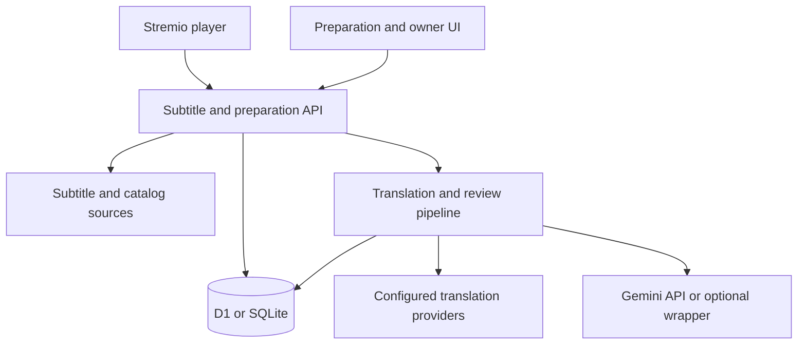
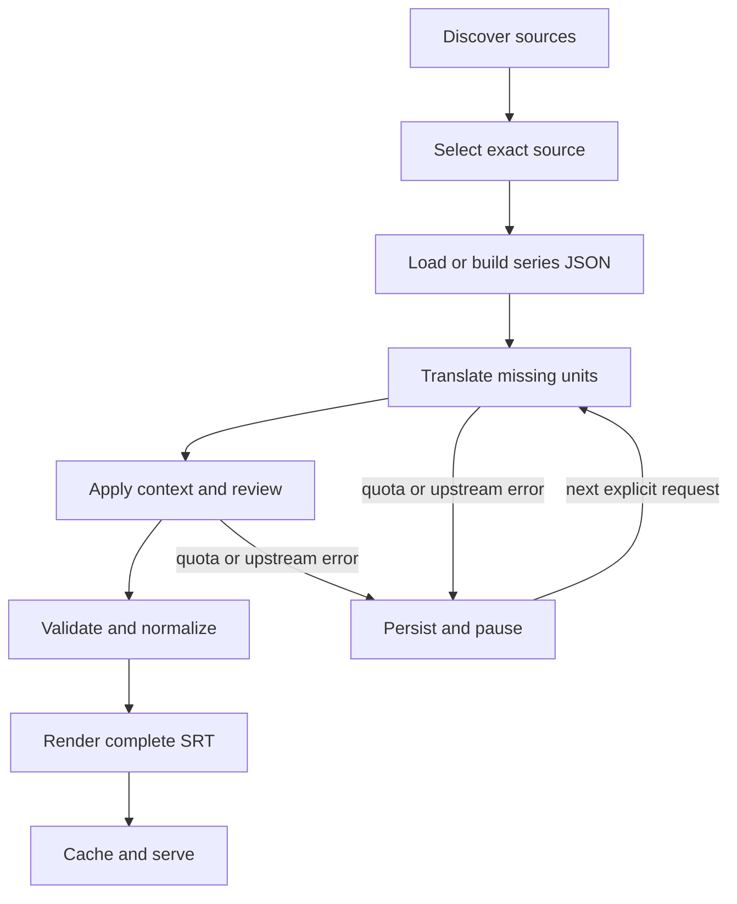
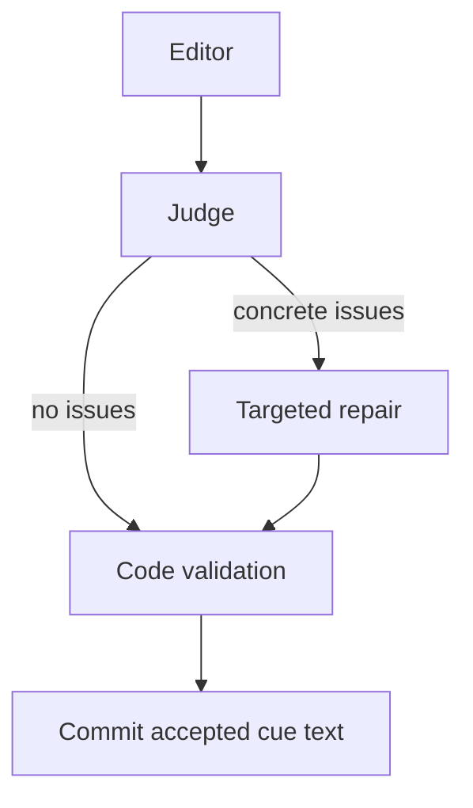

# Subtitle Bridge: architecture and processes

**Baseline:** hosted v0.16.0, exported 2026-10-26. This document describes implemented behavior. Proposed production improvements are explicitly separated at the end.

## 1. Problem and scope

Stremio can play a movie or episode for which a usable Hebrew subtitle is absent. An English file may exist, but a plain translation often loses terminology, gender, sentence continuity, release-specific timing, and consistent spelling across episodes.

Subtitle Bridge is a subtitle resource and preparation service. It fetches existing subtitle text, translates it, reviews it, and serves a complete SRT. It does not fetch video/audio media, transcribe speech, inspect all installed Stremio add-ons, or identify arbitrary speakers from video. “No source” means no usable source from the queried providers, not that no subtitle exists anywhere.

Design priorities:

1. Retain the chosen source file and original parsed timestamps.
2. Never serve a partially translated or structurally misaligned file.
3. Make repeat work cheap while keeping different releases distinct.
4. Improve Hebrew fluency and terminology within available free-service quotas.
5. Persist progress so cancellations and retries do not erase completed work.
6. Distinguish verified release matches from guesses.

## 2. System components



The Cloudflare build combines the Vinext/React UI with the Worker API and D1. The standalone Node adapter exposes the same core API against SQLite, with a minimal root page. The application core is written in ESM JavaScript; UI and runtime glue use TypeScript/TSX.

| Component | Source | Responsibility |
| --- | --- | --- |
| Request dispatcher | `lib/addon.mjs` | Routing, configuration, orchestration, leases, accounting, source selection, complete-file delivery |
| Source discovery | `lib/subtitle-sources.mjs` | Parallel OpenSubtitles providers, normalization, URL deduplication, partial-outage policy |
| Release identity | `lib/releases.mjs` | Source IDs, labels, match status, setup release options |
| Subtitle representation | `lib/subtitles.mjs` | SRT/VTT parsing, segmentation, language normalization, rendering |
| Indexed translation | `lib/google-rpc.mjs` | Bundled independent requests, response/source validation |
| Legacy translation | `lib/google.mjs` | Marker alignment and bounded individual recovery |
| Provider policy | `lib/providers.mjs` | Google / LibreTranslate / DeepL / MyMemory chain |
| Quality reconstruction | `lib/quality.mjs` | Conservative sentence grouping, redistribution, exact glossary |
| Hebrew rules | `lib/hebrew.mjs` | Source-guarded editorial terms and narrow repairs |
| Multilingual evidence | `lib/context.mjs` | Reference selection, timing alignment, conservative consensus |
| Series memory | `lib/series-memory.mjs` | Context extraction, validation, merge, relevant slices, term enforcement |
| Review graph | `lib/refinement.mjs` | Editor, judge, optional repair, response validation |
| Request history | `lib/request-history.mjs` | Discovery coalescing, canonical history, owner list/pagination |
| Browser queue | `lib/queue.mjs`, `app/BatchPrepare.tsx` | Sequential episode preparation, retry groups, pause semantics |
| Portable auth | `server/access.mjs` | Admin token/cookie boundary and hosted-header sanitization |
| Node storage adapter | `server/sqlite.mjs` | D1-shaped bound queries, migrations, transactional batches |

## 3. Principal entry points

- **Stremio discovery:** GET a configured `/addon/.../subtitles/...json` resource.
- **Source selection:** GET a server-issued `/translations/<digest>.srt` URL.
- **Preparation UI:** POST `/api/prepare`, then drive `/api/jobs/<id>/step`.
- **Direct file:** GET `/files/<job-id>.srt`; this may run bounded preparation before returning a complete SRT.
- **Owner monitoring:** `/requests`, `/api/requests`, and `/api/context/<series-id>`.
- **Batch preparation:** the browser enumerates released episodes and invokes the same single-episode primitives.

The API reference documents route details. Configuration IDs and job IDs are random 128-bit bearer capabilities. Translation links use server-issued SHA-256 identifiers associated with server-side bindings; clients cannot submit an arbitrary URL for download.

## 4. Discovery and release selection

### 4.1 Upstream discovery

The service queries standard OpenSubtitles v3 and OpenSubtitles v3+ concurrently. The request includes validated media type, IMDb episode/movie ID, and supported `filename`, `videoHash`, and `videoSize` extras. With references enabled, the query also requests French, Spanish, and Russian sources.

Responses are size/time bounded. Entries are normalized so standard filename/release metadata can be used as a title. Exact subtitle URLs are deduplicated across providers.

One healthy provider can supply a usable result when another fails. An upstream outage plus no usable result is reported as unavailable, rather than cached as proof that no subtitles exist.

### 4.2 Verification versus ranking

| Evidence | Result |
| --- | --- |
| Requested hash equals a supplied subtitle movie hash | Hash matched |
| Supplied hash explicitly differs | Different video hash |
| Exact normalized video filename equals available release/file metadata | Filename matched |
| Only title/episode words or missing metadata | Timing unverified |

Common tokens such as a series name or `S01E43` can influence ranking but cannot establish synchronization. A resolution match alone is insufficient. Provider data may not identify an encoder, distributor, or cut, so automatic exact matching is not always possible.

### 4.3 Keep source choices distinct

Each English subtitle URL is hashed into a source ID. The Stremio response exposes distinct subtitle IDs and supported picker labels, including source identifiers and verification status. A native Hebrew file or completed machine translation cannot cause the episode's other English sources to disappear.

The default candidate may create or reuse a job during discovery. Alternatives use lazy source-bound links. Listing alternatives does not translate them all.

A translation-link record stores:

- Installation configuration key.
- Exact media ID/type/extras.
- Selected upstream subtitle object and source ID.
- Reference candidates available at discovery.

On GET, this binding selects the exact stored source URL rather than reranking a changed listing. Its download is still subject to the HTTPS/host/redirect policy. Source-link expiry is seven days; refreshing discovery creates/renews choices.

### 4.4 Prepared files and content reuse

Prepared metadata is keyed by media/target/source ID. Old records that lack a source ID remain visibly unverified and cannot suppress other sources.

The translation job's content key is based on the entire parsed cue array, including text and start/end timestamps, target, media scope, quality/context versions, provider-chain identity, and refinement identity. Consequently:

- Same English words with shifted timestamps produce a different job.
- Different target/provider/model identities do not share a job.
- Two source choices with genuinely identical parsed cues may share computation while retaining separate source choices/labels.

## 5. End-to-end process



The paused branch is conceptual: the persisted cursor determines whether resumption continues context extraction, translation, or review. Resumption does not blindly restart translation.

### 5.1 Parse and plan

SRT and WebVTT inputs are parsed into timed cues. Invalid timing, empty data, HTML/error pages, and broken text are rejected where detectable. Formatting tags are removed; this export does not preserve ASS typography or infer timing from audio.

Work contains:

- `cues`: original time slots and references into work units.
- `units`: source text, translation state, attempts, optional reference evidence.
- Optional sentence-reconstruction bookkeeping.
- Context, review cursor, timings, and output revision.

Identical text can be deduplicated as a translation unit. Original cue order/timestamps remain separately represented.

### 5.2 Conservative sentence reconstruction

Short adjacent lowercase continuations may be grouped into one translation unit. Explicit speaker turns, complete sentences, long gaps, upper-case starts, excessive combined length, and ambiguous boundaries are excluded by guards.

Translated whole words are redistributed proportionally into the original cue slots. If the result cannot supply every slot, the affected work is split into independent units and retried. This retains timestamps, but does not prove perfect semantic word-to-audio allocation.

## 6. Series context JSON

### 6.1 First pass

Before translation/review of eligible Hebrew jobs, an LLM reads the episode source in bounded chunks and proposes named entities. The scan cursor is checkpointed. Ordinary episodes often fit one request; larger sources require more checkpoints.

Categories include characters, locations, powers, weapons, organizations, titles, and other named entities. Existing project editorial defaults seed the Bleach glossary. These are editorial conventions, not an official localization.

Illustrative persisted structure:

```json
{
  "version": "series-bible-v1",
  "entities": [
    {
      "name": "Example Character",
      "he": "דמות לדוגמה",
      "kind": "character",
      "aliases": [],
      "variants": [],
      "gender": "unknown",
      "evidence": {
        "episode": "tt1234567:1:1",
        "cue": 12,
        "quote": "Example Character is here."
      }
    }
  ]
}
```

This is a schema example, not a claim that such a character exists.

### 6.2 Validation and evidence

Model output is untrusted. The validator requires the proposed name and exact cited quote to occur in the cited English cue. Aliases must occur in supplied English data. Accepted Hebrew variants must be found in provided drafts associated with the entity, with short/common-word exclusions.

Gender is stored only for a character with explicit compatible evidence in the cited source. Otherwise it is `unknown`. This check constrains the model; it is not a general semantic proof that every pronoun was assigned correctly. Character gender must never identify an unnamed speaker or addressee.

Subtitle text and glossary payloads are quoted data, never instructions. Extraction is capped, individual field lengths are bounded, and no extraction result can directly change timestamps or execute tools.

### 6.3 Merge and concurrency

Memory is scoped by version, media/series ID, target, and model. New episodes consult the existing document before proposing additions.

Established Hebrew spellings remain locked. Conflicting gender becomes unknown and is marked as a conflict. Ambiguous aliases shared by different entities are removed. Optimistic compare-and-swap writes retry a bounded number of times, preventing two episodes from silently overwriting one another's updates.

The document is stored in `lookups`, with a 180-day TTL renewed on curation writes. Each job retains the context snapshot used for its review. This is a shared series glossary, not per-user personal memory or external web research.

### 6.4 Use in review

A relevance filter selects entries mentioned in the current batch or immediate neighbors. Only that slice goes to editor, judge, and repair prompts. This reduces redundant context and keeps the same spelling policy in all three passes.

Source-guarded exact normalization also applies known variants. It uses term boundaries and a simultaneous replacement pass rather than arbitrary substring rewriting. Explicit honorifics such as Mr./Miss are preserved. Operator-supplied glossary terms take final precedence.

## 7. Translation providers and fallback

Google indexed RPC is the configured no-key path. It bundles independent source requests in one HTTP request. Every response must map to the expected request ID and echoed source. Out-of-order responses are allowed; duplicated, unknown, missing, or mismatched source assignments are not silently accepted as aligned output.

The marker-based path validates all markers before committing a batch. Alignment failures reduce the batch size and eventually use independent requests. Individual recovery processes one bounded concurrency wave of four units, preserving successful units even if another request fails.

Provider options:

| Provider | Configuration | Important distinction |
| --- | --- | --- |
| Google web RPC | `GOOGLE_TRANSLATE_ENABLED=true` | Unofficial, no key, undocumented upstream limits |
| LibreTranslate | URL and optional key | Operator-hosted OSS service; compute is not free by definition |
| DeepL | API key | Official account quota/billing applies |
| MyMemory | No replacement provider configured | Optional user email requires explicit consent |

Only configured fallbacks are used. No arbitrary public demo server, credential rotation, or invented user identity is introduced on failure. Source text may be sent to the selected provider; the privacy document describes additional MyMemory IP/email handling.

## 8. Optional multilingual evidence

French, Spanish, and Russian tracks are selected from eligible non-machine-labelled candidates. Foreign text must align locally with the English cue interval: tight boundary tolerance, sufficient overlap, bounded cue count, and no excessive gaps.

References do not replace English as the meaning authority. Two agreeing references can support a conservative alternative; narrow single-reference rules cover explicit forms such as singular address. Conflicts, drift, or unrelated passages are rejected. Generated references and duplicate-uploader evidence are constrained by the implemented checks.

Translation calls for reference text count toward the same accounting caps. The system does not assume that any language automatically recovers missing speaker identity.

## 9. Hebrew review graph



Each item has an immutable cue ID, authoritative English, Hebrew draft/candidate, duration, selected references, and bounded neighbor context.

The editor returns only changed cue text. The judge flags concrete meaning, omission, grammar, unsupported gender, term, continuity, length, or script problems. Repair operates only on listed items. There is one targeted repair pass, not an unbounded self-improvement loop.

Prompts preserve meaning, tense, negation, numbers, modality, names, titles, subject/object roles, and transitivity. They request natural concise Hebrew and treat subtitle data as quoted content. Output uses JSON schemas instead of asking the model to rewrite an entire SRT.

Code rejects unknown/duplicate IDs, empty replacements, excessive length, Arabic script in Hebrew output, and unsuitable replacements. Readability guards prefer at most two 42-character lines and approximately 20 characters/second. These are review goals with conservative fallbacks, not a guarantee that every subtitle meets every preference.

Default review batches contain up to 96 eligible cues, bounded by 32,000 input characters. Timeout/malformed-response recovery reduces batches, down to 24. Not every reconstructed or repeated unit is eligible for per-cue review; excluded units retain their guarded baseline translation.

API quota/auth/model errors pause the job. A non-retryable review failure at the minimum batch size can retain the draft and record a failed batch. A “ready” file therefore does not imply every cue received a successful LLM edit; inspect review failure metrics.

## 10. Job state and checkpoint ownership

| State | Meaning |
| --- | --- |
| pending | Work admitted and saved |
| processing | Context, translation, or review is incomplete |
| paused | A provider/config/quota failure requires later resumption |
| ready | All units translated and required review cursor finished |

The owner request ledger separately records discovering, existing, missing, error, and expired outcomes.

A job step acquires a lease through an atomic conditional database update. Official-API jobs use a two-minute lease; the optional anonymous wrapper path without an API key retains a six-minute lease. A busy caller observes saved progress rather than running a second translation wave.

Every commit checks lease ownership again. An expired/stale worker cannot overwrite the current owner's progress. Successful units and review cursors are checkpointed; a retry translates only unfinished work.

A dedicated context-extraction checkpoint runs before the normal translation step. Context, translation, and review have separate timing counters.

## 11. Repeated requests and discovery coalescing

Stremio may first send a filename-only request, then a hash/size-enriched request, and repeat both. These are not necessarily separate user actions.

The discovery fingerprint includes release-matching/context versions, media, normalized extras, target, selected source, provider/refinement identities, and relevant quota identity. Site-funded providers share work across changing proxy/device IPs; MyMemory preserves its quota identity isolation.

An atomic preflight claim leases discovery for 90 seconds. Overlapping identical requests wait briefly for the first response. Successful responses are reused for five minutes; linked job progress is refreshed on a hit. Saved errors use a much shorter expiry. An orphan claim eventually expires.

Filename-only and enriched requests may group in history only after resolving to the same job and compatible filename/source label. Different source labels retain separate records even if computation can be shared for identical cues. Hits and last-seen timestamps make repeat activity visible.

## 12. Storage and retention

| Table | Content | Typical lifetime |
| --- | --- | --- |
| configs | Target language and optional consented email | 180 days |
| jobs | Source cues, translated units, state, lease, metrics, contact/quota attribution | 7 days from creation |
| lookups | Discovery, parsed sources, source links, series JSON, rendered files, cooldowns | Per-key TTL |
| counters | Rate and character reservations | Window-dependent |
| subtitle_requests | Media/release/request outcome, linked job, hit count | 30 days |

Important lookup TTLs: source listings roughly 15 minutes; negative provider discovery one minute; parsed source files one hour; title/episode metadata one hour; successful request-flight responses five minutes; translation links seven days; series memory 180 days. A request-flight cache can temporarily outlive a provider's negative cache.

Expiry is checked on reads. Cleanup is opportunistic, bounded to avoid long scans, and gated to once per five-minute window. Expired inactive rows may remain physically stored until cleanup runs. TTL is not a scheduled hard-deletion guarantee.

Browser localStorage contains configuration choices and batch-queue progress, not the server's subtitle cache. Completed translations are shared by exact content/engine identity, not uploaded into the user's Stremio account or published back to OpenSubtitles.

## 13. Quotas and concurrency

Character reservations use atomic UPSERTs before provider work. Failed attempts and retries count conservatively. Admission checks a per-track cap but does not guarantee the daily/monthly balance will still be available when later batches run.

Google has an application-wide monthly protective cap, normally five million code points in this configuration; other configured services use their configured protective cap. These numbers are application settings, not provider entitlements. Daily limits and route-level lookup/search/step limits are additional controls.

At most four independent fallback calls run concurrently in one step. The LLM graph is sequential because the judge depends on the editor and repair depends on the judge. Season queues are sequential per browser queue. Parallel discovery/provider queries do not imply all translations run concurrently.

## 14. File serving, cancellation, and cache revisions

A file GET may relay bounded steps for approximately 75 seconds, with a maximum number of processing invocations. Only a complete ready job is rendered as SRT. A busy or unfinished job returns a retryable response rather than inserting a progress message into subtitle cues.

Rendered output is cached under job/output revision. Content-derived ETags distinguish changed translations, including a glossary-driven re-review of an old completed job. The serving path reapplies guarded terminology normalization with operator precedence. Source-choice URLs remain separate even when a complete file is reusable.

Worker `waitUntil` gives active file/step/translation-link work a bounded chance to checkpoint after client disconnect. It is **not** an unattended durable queue. A player can still abandon a first translation; an open preparation page or Finish translation control can continue from saved progress.

The standalone Node process uses the same bounded orchestration but does not inherit Cloudflare execution guarantees. Process death still requires another request to resume saved work.

## 15. Owner activity and portable authentication

The hosted edition relies on a trusted identity proxy. That trust must not be copied onto an arbitrary public server.

The portable adapters strip all client-supplied hosted-identity headers. They authenticate an instance administrator using a configured random token via Bearer authorization or a short-lived HttpOnly, SameSite=Strict cookie. Only then are internal owner headers injected for the existing history/context authorization checks.

Missing or placeholder secrets fail closed. Use HTTPS in production. The dashboard never exposes stored IP/email/configuration secrets. Public job/file URLs remain bearer capabilities; owner authentication is not retroactively applied to all subtitle downloads.

## 16. Operational limits and next work

Implemented safeguards do not establish production certification. Remaining work includes sustained multi-user load testing, independent security review, human-rated Hebrew quality evaluation, a real-device compatibility matrix, backup/restore drills, alerting, and capacity planning.

A durable background queue with admission/ownership controls is the next architectural step for fully unattended seasons. Stronger source metadata or video-aware alignment would improve matching when upstream hashes/release groups are missing. External character/lore research, speaker recognition, and guaranteed gender inference are not implemented.

The free-service path can pause or break if an unofficial endpoint changes. Maintaining the system requires honest quota handling and optional authorized fallbacks, not promises of unlimited free translation.
